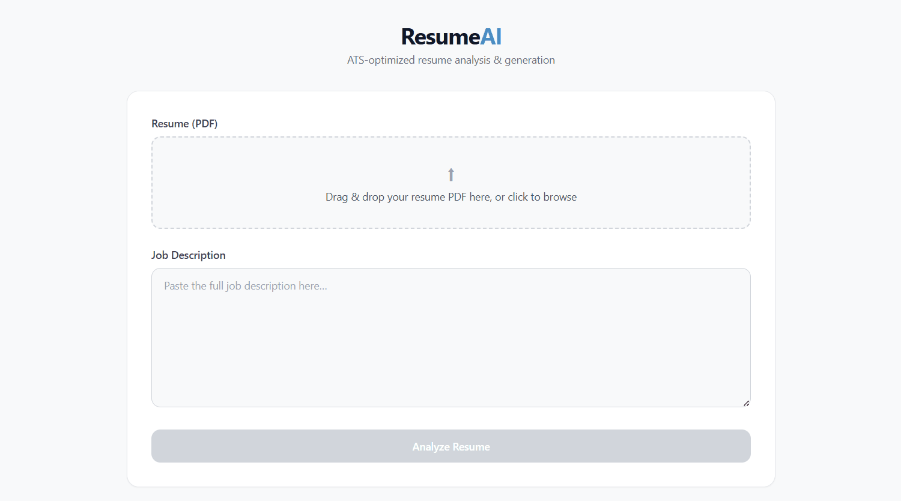

# ResumeAI

ATS resume analyzer: upload a resume PDF and a job description, get a match score with a skill gap analysis, and download a tailored resume PDF.

## Demo



## Project Structure

```text
ResumeAI/
├── backend/
│   ├── api_app.py                  ← FastAPI app (3 endpoints)
│   ├── cli.py                      ← Command-line entry point (single JD or --multi-jd)
│   ├── pipeline.py                 ← Shared orchestrator: Stage 1 → 2 → 3 (used by API and CLI)
│   ├── parsing/                    ← Stage 1: resume PDF + JD parsing (PyMuPDF, regex)
│   ├── scoring/                    ← Stage 2: TF-IDF + semantic scoring, skill gap analysis
│   ├── generation/                 ← Stage 3: resume assembly + PDF generation, multi-JD heatmap
│   ├── scripts/
│   │   ├── smoke_api.py            ← End-to-end check against a running API
│   │   └── make_sample_resume.py   ← Regenerates the synthetic sample resume
│   ├── tests/                      ← pytest suite (offline, no model download)
│   ├── data/                       ← Synthetic sample resume + sample JDs
│   ├── requirements.txt            ← Pipeline dependencies
│   ├── requirements-api.txt        ← Web API dependencies
│   └── requirements-dev.txt        ← Tests, smoke test, linting
├── frontend/
│   ├── app/page.tsx                ← Single-page app (upload → results → download)
│   ├── components/ScoreRing.tsx    ← SVG radial gauge
│   ├── components/SkillChips.tsx   ← Color-coded skill chips
│   ├── next.config.mjs             ← Proxies /api/* → FastAPI (RESUMEAI_API_URL, default :8000)
│   └── package.json                ← Next.js 14 + Tailwind
└── .gitignore
```

## Pipeline

```text
Resume PDF + JD text
  → Stage 1: parse_resume() + parse_jd()
  → Stage 2: score_resume(): TF-IDF + semantic (all-MiniLM-L6-v2) + gap analysis
  → Stage 3: assemble_resume() → [inject_missing_skills(), opt-in] → generate_resume_pdf()
  → Tailored PDF + score dashboard
```

Skills are compared by canonical name, so "React.js" on a resume matches "React" in a JD, and "k8s" matches "Kubernetes". The tailored resume keeps every job in its original order. It reorders bullets by relevance and shows the most relevant projects.

## Quick Start

### Prerequisites

- Python 3.10+
- Node.js 18+

### 1. Backend

```bash
cd backend
python3 -m venv .venv
source .venv/bin/activate
pip install -r requirements.txt -r requirements-api.txt
python -m uvicorn api_app:app --reload --port 8000
```

The first analysis downloads the sentence-transformers model (~80 MB, one time).

### 2. Frontend

```bash
cd frontend
npm install
npm run dev
```

### 3. Use

Open **http://localhost:3000**, upload a PDF, paste a JD and click **Analyze Resume**. You then see the scores and can click **Download Tailored Resume**.

Tick **"Add the job's missing skills"** only if you really have those skills. Leave it unticked and the tailored resume lists only what your resume already says.

## Command Line

Run from `backend/` with the venv active:

```bash
# One JD → tailored PDF, gap report JSON and scores JSON in results/
python cli.py --resume data/sample_resumes/resume.pdf --jd data/sample_jds/jd1.txt

# Also add the JD's missing skills to the skills section
python cli.py --resume data/sample_resumes/resume.pdf --jd data/sample_jds/jd1.txt --add-missing-skills

# Score one resume against every JD in a folder (heatmap + bullet CSV + best-match PDF)
python cli.py --resume data/sample_resumes/resume.pdf --jd-dir data/sample_jds/ --multi-jd
```

`python cli.py --help` lists every option.

## API Endpoints

| Method | Path                     | Description                                                                  |
| ------ | ------------------------ | ---------------------------------------------------------------------------- |
| `POST` | `/api/analyze`           | Form fields `resume` (PDF), `jd_text`, optional `add_missing_skills` → JSON |
| `GET`  | `/api/download/{job_id}` | Download the generated tailored PDF                                          |
| `GET`  | `/api/health`            | Health check                                                                 |

Swagger docs are at **http://localhost:8000/docs**.

| Environment variable       | Default                                       | Meaning                                  |
| -------------------------- | --------------------------------------------- | ---------------------------------------- |
| `RESUMEAI_MAX_UPLOAD_MB`   | `10`                                          | Largest accepted resume upload           |
| `RESUMEAI_JOBS_DIR`        | `$TMPDIR/resumeai_jobs`                       | Where generated PDFs are kept            |
| `RESUMEAI_JOB_TTL_SECONDS` | `21600` (6 h)                                 | How long generated PDFs are kept         |
| `RESUMEAI_MAX_CONCURRENT`  | `2`                                           | Analyses run at once (the rest queue)    |
| `RESUMEAI_CORS_ORIGINS`    | `http://localhost:3000,http://127.0.0.1:3000` | Allowed browser origins                  |
| `RESUMEAI_API_URL`         | `http://localhost:8000`                       | Frontend only: where `/api/*` is proxied |

The uploaded resume is deleted as soon as the analysis finishes. Only the generated PDF is kept, until the TTL expires.

## Testing

```bash
cd backend
pip install -r requirements-dev.txt

# Unit tests: offline and fast (no model download)
python -m pytest

# Lint
ruff check --select E9,F,B,UP,PIE --target-version py310 . --exclude .venv

# End to end against a running API (exits non-zero on failure)
python scripts/smoke_api.py

# Or by hand
curl -X POST http://localhost:8000/api/analyze \
  -F "resume=@data/sample_resumes/resume.pdf" \
  -F "jd_text=Software Engineer. Requirements: Python, React, Node.js, SQL."
```

Frontend checks: `cd frontend && npm run lint && npm run build`.

## Tech Stack

| Layer      | Stack                                                                      |
| ---------- | -------------------------------------------------------------------------- |
| Parsing    | PyMuPDF, regex                                                             |
| Scoring    | sentence-transformers (all-MiniLM-L6-v2), scikit-learn TF-IDF              |
| Generation | pdflatex + Jinja2 when TeX is installed, otherwise reportlab (same sections)  |
| API        | FastAPI, uvicorn                                                           |
| Frontend   | Next.js 14, React 18, Tailwind CSS, TypeScript                             |
